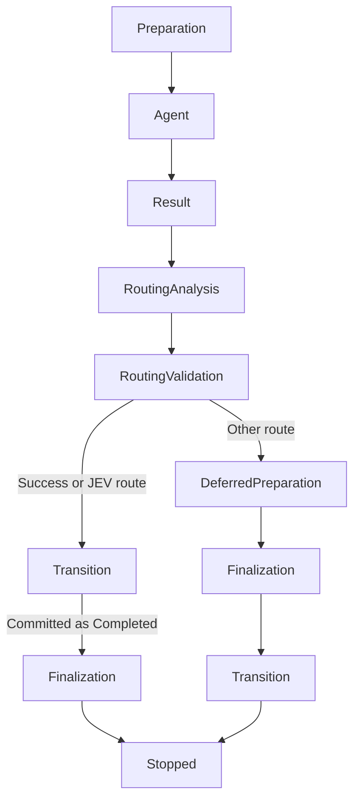

# Pipeline and column processing

## Purpose

Projects can contain multiple independent pipelines. Each pipeline and column has a stable numeric identity, so display names can be changed without breaking tickets, processors, skills, or routing rules.

This model is intended for business workflows where a ticket is claimed from a column, processed once, and routed to its next business state. Independent scheduled tasks handle cron/interval work. No fixed agent-role pipeline is required or initialized.

## Domain model

- A project owns one or more `Pipeline` records. Renaming a pipeline changes only `Name`; its `Id` and stable `Slug` remain unchanged.
- A pipeline owns ordered `BoardColumn` records. Column names are unique only within their pipeline.
- Tickets reference both `PipelineId` and `ColumnId`. The legacy `Status` string remains synchronized with the column name.
- A column has a semantic `ColumnRole`: `Normal`, `Waiting`, `OwnerAction`, `Success`, or `Failure`. Logic relies on the role, not on translated or user-editable names. `Waiting` is reserved for non-human pauses; `OwnerAction` marks a decision or missing input and assigns the ticket to the owner.
- `Waiting` and `OwnerAction` columns may define Markdown `UserGuidance`. The ticket panel always shows an unblock block between description and activity. When guidance is empty, KittyClaw derives a safe explanation from the schedule, blocking children, column role, and nearby success/failure destinations.
- One optional `ColumnProcessor` is attached to a column by stable `ColumnId`. Its optional `Model` overrides the project-level local model; leaving it unset uses the project local model when configured, otherwise the selected provider's default.

There is deliberately no required `InProgress` business column. A durable `ColumnExecution` records `Running`, `Retrying`, `WaitingForChildren`, and terminal execution states while the ticket remains in its current business column.

## Manual ticket transitions

Manual moves reuse the source column processor's routing graph. As soon as that processor declares
a default destination, outcome routes, a technical-failure destination, or action-failure
destinations, the board and ticket API only accept those destinations for an interactive move.
Processor and scheduled-action routing remain authoritative and bypass this user-facing guard.

A column without any declared routing destination stays unrestricted. This preserves legacy boards
and ensures a partially configured workflow cannot strand a ticket with no available move.

## Processing lifecycle

`ColumnProcessingEngine` is event-driven, with a low-frequency watchdog for delayed retries and configuration changes. This lifecycle applies to agent processing, including an explicitly enabled classic fallback from a JEV-only mode. See the [temporal option map](#temporal-column-editor) for entry rules and JEV-only branches. For an eligible enabled agent processor it:

1. claims one eligible ticket using the configured order;
2. creates a durable execution claim, protected by a unique active-ticket index;
3. dispatches the generic column agent with its current mission, persistent memory, ticket context, and project skills;
4. validates and saves the structured outcome, required-skill report and requested acceptance assessments with evidence;
5. runs the native memory-capitalization checkpoint;
6. selects an outcome route (switch-like rule) or the default route;
7. moves the ticket atomically to the target column, possibly in another pipeline.

Explicit ticket dependencies are checked before claiming new work, delayed or manual retries,
interrupted executions, and parents resuming after their children finish. A prerequisite is
resolved only when its current column has the `Success` role, using the same definition as
the legacy dispatch gate. Cards with unresolved prerequisites stay in their current column
(including Todo), without comments, new executions, or consumed retry attempts. The filter
runs before the candidate window so other eligible cards can be selected. Once all prerequisites
reach success, the next engine scan can claim the card. `Blocked` is reserved for obstacles
requiring external intervention or an indispensable decision, rather than ordinary delivery dependencies.

### Explicit execution states

`ColumnWorkFlow` resolves admission from the same `ColumnProcessingState` used by the editor:
None is disabled; triage waits for routing; review waits for the owner; profile selection waits
for an approved profile. A current inconclusive JEV result can admit an agent only when the
mode permits its fallback. Entry, dependency and concurrency gates still run in the claim service.
Retries and child-wait resumption keep their existing durable claim instead of creating new work.

After admission, `ColumnProcessingEngine.RunStagesAsync` executes one stage at a time.
`ColumnExecutionFlow.Next` is the transition table:



Preparation defers before-actions whenever a Success destination exists. Deferred preparation
runs them only when they were deferred; finalization includes them after a guarded transition.
Any rejected stage stops the flow. Result recording includes the durable agent result, acceptance
evidence and memory capitalization, before routing analysis. A failed final compare-and-swap cannot
enter finalization on the guarded path.

These orchestration states are transient: `ColumnExecutionStatus`, `AgentCompleted`, completed
action IDs and `CurrentActionId` remain the durable recovery authority. A saved agent result skips
dispatch; an indeterminate external action is held/routed before entering the flow and never replayed.
Child completion clears the prior wait result so the agent can make a new decision. JEV triage and
review workers resolve the same admission states; the review decision remains owner controlled.

### Native processor-memory capitalization

Processor lessons use a single canonical `.agents/processors/column-<column-id>/memory/MEMORY.md`.
A bounded generated section holds the newest 50 normalized, deduplicated lessons with stable
execution checkpoint markers. Handwritten memory outside that section is preserved. On the next
capitalization, the former `pipeline-lessons.md` journal is merged into the canonical file before
the known generated legacy file is removed. One atomic replacement makes a restart or retry
idempotent without a derived index to repair. Unknown legacy content is retained for review.

The structured business result (including lessons) is saved in SQLite before memory persistence.
Memory publication is independent of business routing: a refused Git hook records `RetryRequired`
and its error without consuming business attempts, overwriting the outcome, or selecting the
technical-failure route. The card and ticket panel expose **Retry memory only**, including on
historical completed or cancelled executions; this action never dispatches an agent or routes a
ticket. Its durable status survives restarts. Concurrent recovery requests are serialized and a
successful checkpoint is not executed again. Failed business processing, delayed retries and
waiting parents also expose their state and explicit recovery actions on the card.

Every KittyClaw memory write is checkpointed immediately, independently of business routing.
This includes creating or migrating processor memory. Commits include only native memory paths,
preserve unrelated staged files, check for probable secrets and execute the project's Git hooks.
Ignored untracked memory stays local; already tracked memory remains versioned even if a later
ignore rule matches it. KittyClaw never installs Git hooks for this feature. Processor discovery
and unchanged memory reads do not retry outstanding commits: an external reservation must not
prevent a whole project's processors from selecting their next ticket. Ticket worktree writes use the ticket
route; maintenance writes retain their integration-queue lifecycle. Non-Git workspaces retain
file-based memory.

Manual column changes supersede old failed, delayed or waiting claims in the same save as the
ticket move, preserving results, lessons, errors and action history. A running claim retains its
unique reservation until the worker stops post-processing or startup recovery cancels the stale
trigger. An away-and-back move cannot revive its old outcome. The next claim reads the latest
owner comment from durable storage, even after restart, and the dispatch includes current
comments plus previous deliveries as context. Agents are instructed to continue from delivered
artifacts and existing reservations rather than repeat that work; old outcomes are never routing
instructions. Non-success routing also checks the durable claim and ticket version under the
SQLite write lock before committing a transition.

For a `changes_requested` result, the engine finds the most recent completed execution that routed
the ticket into the validating column and also records the feedback in that upstream processor's
memory. This attribution remains valid if either processor is later disabled because it uses stable
processor and column identifiers.

Processor memory is distinct from specialist memory under `.agents/<specialist>/memory/`. It uses the native execution checkpoint independently of ad-hoc chat memory consolidation.

Before a route with the `Success` role is applied, the execution must consume the current ticket
version and, for an `owner-feedback` signal, the exact triggering owner comment plus fresh delivery
evidence. The final transition uses a database compare-and-swap on `Tickets.UpdatedAt`, in the same
transaction as the execution and activity records. A failed refresh, stale version, or unconsumed
owner comment records `ticket_refresh_failed`, `stale_ticket_context`, or
`owner_feedback_not_consumed`, then follows the configured technical retry/failure path without
running configured actions or persisting partial success effects. Runs without owner feedback may
consume an explicitly evidenced current ticket version, preserving legacy and custom outcome routes.

After the host reports `ApplicationStarted`, interrupted executions are recovered for every project, including projects that are paused. This keeps HTTP health and root responses available before recovery work begins. Recovery updates the durable execution state without dispatching new work; processing resumes only after the project is unpaused.

A route cannot point back to its source column. Repeating work is expressed through the explicit retry policy, avoiding accidental processing loops.

Provider sessions are scoped to the ticket's current column visit. Every column change
(including leaving and returning to the same column) starts a fresh session. SQLite
increments `Ticket.ColumnVisit` atomically for all transition writers. A dispatch that
resumes within the same visit reuses its session and receives the complete current
processor profile and ticket context again, so configuration edits take effect.
Completed-agent checkpoints still skip dispatch when only platform post-processing remains.

The cross-column loop guard uses a ten-minute window and compares the two most recent
occurrences of the same source-to-target transition. Each completed execution persists a
SHA-256 progress fingerprint built from its persisted structured agent result (outcome and
summary), completed action checkpoint ids, and relevant ticket comments added during the
execution (including delivery references, diagnostics, and evidence). Comments authored by
`automation`, `system`, or `kittyclaw` are excluded. Unicode compatibility, whitespace,
case, punctuation, and ISO timestamp-only differences are normalized, so automatic or
cosmetic noise cannot reset the guard. Replaying an already completed action is idempotent
because checkpoint ids are deduplicated. The guard fires only when both transition and
fingerprint repeat. Its synthetic execution stores the compared execution ids, window,
fingerprint, accepted signals, and decision reason in `LoopDiagnosticJson`. The ticket stays
in its current business column with its latest checkpoint intact; retrying the failed
synthetic execution provides an explicit recovery path instead of routing to terminal failure.

Technical failures use exponential backoff up to `MaxAttempts`. Before a delayed retry is claimed,
the engine atomically revalidates the ticket's triggering column and recorded ticket version. A stale
retry becomes terminal `Cancelled` with `stale_trigger_context`, without dispatching an agent or
scheduling another attempt. Once valid retries are exhausted, the ticket can be routed to a dedicated
technical-failure column. A failed execution can also be retried or cancelled through the API.

An agent outcome of `scheduled` must include `fireAt` and `scheduleTarget`. Its configured route must lead to a column with the `Waiting` role; validation uses that stable role rather than the column's editable display name. The wake target must name an existing column in the destination pipeline.

## Temporal column editor

The editor has **Identity**, **Ticket path**, and **Scheduled tasks** tabs. The ticket
path uses numbered, expandable phases in execution order. Entry capacity and acceptance
requirements always come first and apply independently of the processing mode.

The second phase chooses one exclusive mode: **Do nothing more**, **Work by an agent**,
**Automatic triage by JEV**, or **JEV evidence review, then owner decision**. Do nothing
more disables the processor without deleting its definition; entry rules and independent
scheduled tasks remain in effect. Hidden stages keep their last saved settings. Draft edits remain available while switching modes
in the open editor, but only active stages contribute to a save; incomplete dormant drafts cannot block it.
`ColumnProcessingState` defines modes, transitions and ordered active stages; the editor save projection
uses that same state. Owner routing is distinct from general outcome routing.

Agent processing then shows preparation (ticket order, optional JEV profile selection and
before-actions), execution (mission, model, skills and limits), result/evidence recording,
routing (classic outcome rules or JEV after the agent), and final actions. The conditional
action timing is described below; the position of a hook is not an unconditional promise
that its effects run before or after the agent. Technical retry settings follow the path.

The two JEV-only modes show analysis followed by routing or owner decision instead.
Their **Call an agent if JEV cannot conclude or is unavailable** option controls
`jevFallbackToAgent`. Its agent settings and technical retry settings appear only when
selected. Missing credentials, insufficient evidence/confidence and HTTP failures (including
service budget exhaustion) follow the same policy. Without opt-in, no agent is claimed and
the ticket remains in the column. JEV modes remain configurable without credentials.
New processors created in this editor opt out; existing definitions and older API requests
retain their previous fallback behavior. The option is preserved by processor.json, SQLite,
REST/MCP saves and portable pipeline kit round trips.

### Option map in configuration order

This is the canonical temporal map for both the editor and pipeline-authoring agents.
Names below are REST/MCP request fields; `processor.json` has its own file-backed
routing/action structure. Read the live API before building a request.

| Phase | Options | Effective time and dependencies |
| --- | --- | --- |
| Identity, outside execution | Column `name`, `color`, `role`, position, `userGuidance` | Describe the column and the owner's unblock action. Role is independent of mode. Preserve stable IDs on rename/reorder. |
| 1. Allow entry | `maxTickets`, `capacityBlocking` | Checked before entry in every mode. Zero means unlimited; warning-only capacity is not an entry refusal. |
| 1. Allow entry | `requireAcceptanceCriteria` | A non-empty structured criterion must already exist; no evaluation is performed. |
| 1. Allow entry | `requireValidatedAcceptanceCriteria` | A non-empty checklist must already be entirely `PASS`. Implies criterion presence; produces no evidence or JEV owner approval. |
| 2. Choose mode | Processor presence, `enabled`, `jevObservationOnly`, `jevAcceptanceValidation` | Select the exclusive branch before its dependent options. Do nothing more disables processing, not entry gates or independent schedules. |
| 3. Prepare agent work | `selectionOrder` | Orders eligible agent claims after dependencies are resolved. In JEV-only modes, applies only when a fallback agent is enabled and needed. |
| 3. Prepare agent work | `jevExecutionSelection`, `jevExecutionProfiles` | JEV chooses an authorized model/skills profile before dispatch. Profiles have a name, description, model and skills; required skills remain mandatory. Uncertainty/unavailability uses default model/skills. Incompatible with JEV-only modes. |
| 3. Prepare agent work | Ordered `beforeActions` | Preliminary actions, subject to the success safeguards below. Preserve action IDs, action-specific fields, order and `failureTargetColumnId`. |
| 4. Execute agent work | Processor `name`, `mission`, `prompt` | Define the agent and its task. In JEV-only modes mission/instructions also describe the JEV analysis; a successful analysis does not launch an agent. |
| 4. Execute agent work | `model`, `availableSkills`, `recommendedSkills`, `requiredSkills`, `maxTurns` | Main or opted-in fallback agent settings. Null model inherits project/provider defaults. Profile selection overrides model/skills for a run without changing these defaults. |
| 5. Record result/evidence | `evaluateAcceptanceCriteria` | Agent returns assessments for relevant existing criterion IDs in its final structured JSON. `PASS`, `FAIL`, `PARTIAL` require evidence. Save before routing, then capitalize lessons. Omitted criteria stay unchanged. Only applies when an agent runs. |
| 6. Decide destination | `routes`, `defaultTargetColumnId` | Match saved outcomes, then use the default. Use stable destination IDs, possibly across pipelines, never self-routing. Declared destinations also constrain manual moves. |
| 6. Decide destination | `jevAutomaticRouting` | Optional JEV choice after the saved agent result/evidence. If uncertain/unavailable, use classic outcome/default routing, not a second agent. Only business destinations are candidates. |
| JEV analysis, before decision | `jevConfidenceThreshold` | Shared by enabled JEV features: API/file `0..1`, UI `0..100` percent. Below threshold invokes the appropriate fallback, not automatic acceptance. |
| JEV triage branch: 3 → 4 | `jevObservationOnly`, mission/prompt, authorized routes/default | Historical observation flag means active automatic triage. A sufficiently certain result routes without agent work, criterion-report production or configured before/after actions. |
| JEV review branch: 3 → 4 | `jevAcceptanceValidation`, `jevAcceptanceCriteria` | Examine existing verified evidence against column/ticket criteria, without running tests. A sufficiently certain review waits for the owner, even when all criteria are satisfied. |
| JEV owner decision | Default destination, `changes_requested` route | Approval uses the default; corrections require a reason and use that route. Without it, rejection stays put. Neither approval nor override bypasses destination entry rules. |
| 7. Finalize and leave | Ordered `afterActions`, action-specific failure destinations | Pending final actions run in order with the conditional timing below. Checkpointed actions are not repeated. |
| JEV-only failure branch | `jevFallbackToAgent` | Explicit agent opt-in for BOTH triage and review. Insufficient evidence/confidence, missing credentials, service budget exhaustion and service errors use the same policy. False means no automatic agent and no automatic move. |
| Technical recovery | `maxAttempts`, `retryBackoffSeconds`, `technicalFailureColumnId` | Bound technical agent retries with exponential backoff from the initial delay in seconds, then route exhausted failures when configured. Per-action failure handling remains distinct. Hidden values do not activate an agent when fallback is off. |
| Independent scheduled tasks | `enabled`, name, calendar/`cron`, `timeZoneId`, `ticketScope`, ordered actions and per-action failure settings | Run without an agent on their calendar. Not ticket lifecycle phases; changing the processor mode or choosing Do nothing more does not disable them. Project pause still pauses scheduled execution. |

### Exclusive modes and dependent options

| Mode | Required active configuration | Following configuration |
| --- | --- | --- |
| Do nothing more | No processor, or `enabled=false` | Hide later processing phases; preserve stored processor values, entry gates and schedules. |
| Work by an agent | `enabled=true`, `jevObservationOnly=false`, `jevAcceptanceValidation=false` | Preparation → execution → result/evidence → routing → finalization. Profile selection and post-agent JEV routing are independently optional. |
| Automatic triage by JEV | `enabled=true`, `jevObservationOnly=true`, acceptance/profile/automatic-routing flags false | Ticket analysis → automatic routing. Agent phases exist only under the opted-in failure branch. |
| JEV evidence review, then owner decision | `enabled=true`, `jevAcceptanceValidation=true`, observation/profile/automatic-routing flags false | Evidence analysis → owner decision. Agent phases exist only under the opted-in failure branch. |

`jevPostRunObservation` is a legacy history feature, not an extra mode in this editor;
do not enable it alongside a JEV-only mode. API saves are not uniformly PATCH operations:
read and retain unspecified fields, including enabled state and hidden settings. Explicitly
send `jevFallbackToAgent=false` for new JEV-only definitions unless an agent fallback is
intended; older omitted values default to true. Preserve existing policies on unrelated updates.

### Dependencies across columns and conditional action timing

Entry gates precede all operations in a destination column. Do not require already-validated
criteria in the very column expected to evaluate those unevaluated criteria. Require criterion
presence in the work/verification column, enable agent assessment there, and place an all-`PASS`
gate downstream. JEV review does not itself write agent criterion assessments; owner approval
cannot bypass an all-`PASS` entry gate either.

Before-actions normally run before the agent when no declared business destination has the
`Success` role. Otherwise the engine defers them until the result is available. For a success
outcome or an accepted automatic JEV routing proposal, the engine validates and records the
transition before **pending** configured actions run. Other outcomes run deferred before-actions,
then after-actions, then move. Already completed before-actions are checkpointed and not replayed.
Action-specific failure destinations are recovery paths, not extra JEV business choices.

`KittyClaw.Web/Services/ColumnWorkflowInstructions.cs` shares this contract with planning,
application/reconfiguration turns and KittyClaw project chat. Plans describe each column in this
order; approved changes reload and verify gates, mode, evidence timing, explicit fallback and
independent schedules. `ProjectTemplate/**` remains application-neutral.

## Scheduled column tasks

Columns can own durable cron tasks that execute an ordered action chain without launching an agent. Each run checkpoints completed actions in the project database so a host restart resumes only the unfinished portion. If the project starts paused, interrupted runs are recovered but held in memory; they resume after the project is unpaused, and newly due tasks are not claimed while it remains paused.

`ColumnScheduledTaskService` persists definitions and run checkpoints. `ColumnScheduledTaskEngine` claims due work, recovers interrupted runs, and delegates actions to `ColumnActionExecutor`. Tasks are configured from the **Scheduled tasks** tab in the column configuration dialog.

## Generic agents and project skills

Reusable project capabilities live under:

```text
<workspace>/.agents/skills/<stable-skill-slug>/SKILL.md
```

KittyClaw writes the Codex-compatible YAML frontmatter (`name` and `description`) and keeps the editable instructions as the Markdown body. Reading an older plain-Markdown project skill upgrades it atomically before the next agent process starts.

The processor is a generic agent identity tied to a column. Its persistent memory lives under:

```text
<workspace>/.agents/processors/column-<column-id>/memory/MEMORY.md
```

The runtime prompt names this exact path and reserves current-ticket transitions for KittyClaw. Legacy specialist instructions may inform the work, but a column processor must return its outcome instead of moving or reassigning the current ticket itself.

Skills can be available, recommended, or required. Required skills must be named in the agent's structured result before business routing is accepted. Renaming a skill changes its display name while preserving its directory slug.

## Parent and child tickets

Child tickets may live in any pipeline. `BlocksParent` separates prerequisite work from informational or derived work:

- a non-blocking child never delays the parent;
- a blocking child is successful when its current column has the `Success` role;
- a parent becomes eligible only after every blocking child is successful;
- a running processor may return `wait_for_children` after creating blocking children; its durable execution resumes when they succeed.

This avoids coupling child completion to column names or to the parent's pipeline.

## User interface and API

The board displays pipeline tabs and one pipeline at a time. Pipeline tabs include visible unread counts; hidden child tickets are not counted. During drag-and-drop, routing destinations are highlighted lightly while forbidden columns are subdued and do not expose an active drop target.

Column configuration is intentionally local to the board. Right-click a header and choose **Configure column** to edit the column's identity, role, position, owner guidance, ticket path and independent scheduled tasks in one dialog. The same menu inserts or duplicates columns and marks the column read. The **Workflows** page remains the project-level overview for pipelines and reusable skills rather than duplicating every column editor.

The processor editor exposes models discovered from Claude, Grok, OpenAI Codex, Mistral Vibe, and the project's Ollama endpoint; model discovery is optional, and a previously saved custom value remains selectable when it is no longer advertised. Selecting **Automatic** clears the processor override.

New-project initialization launches a dedicated setup mode after the workspace template is written. KittyClaw analyzes a populated folder, or asks targeted questions for an empty one, then proposes graphical pipelines and columns. The owner can refine each step and must approve the final plan before **Create the workflow** applies it.

Relevant endpoints include:

- `GET|POST /api/projects/{slug}/pipelines`
- `PATCH /api/projects/{slug}/pipelines/{pipelineId}`
- `GET|PUT|DELETE /api/projects/{slug}/columns/{columnId}/processor`
- `GET|POST /api/projects/{slug}/project-skills`
- `PATCH|DELETE /api/projects/{slug}/project-skills/{skillSlug}`
- `GET /api/projects/{slug}/column-executions`
- `POST /api/projects/{slug}/column-executions/{executionId}/retry`
- `POST /api/projects/{slug}/column-executions/{executionId}/cancel`
- `POST /api/projects/{slug}/column-executions/{executionId}/retry-memory` — persist saved lessons only

Ticket creation and update accept stable `pipelineId` and `columnId`. Ticket update also accepts `blocksParent`.

## Compatibility

Existing databases are migrated into a default `main` pipeline. Existing columns and tickets receive stable links, while legacy status strings and APIs continue to work. The retired automation engine no longer reads or executes `.agents/automations.json`. Recurring work uses column scheduled tasks; legacy rule definitions and queue tables are inert and are not imported.

Existing pipelines can be opened with **Edit with assistant** on the Workflows page. This starts from the selected pipeline’s current columns, supports natural-language refinements and a final review, and applies scoped changes while preserving unspecified configuration. This mode preserves other pipelines.

## Optional column capacity

Each column has an optional `MaxTickets` (0 = unlimited) and `CapacityBlocking` (false = warning only), editable in **Ticket path → Allow entry** and through REST/MCP column requests. The board shows the configured capacity and a warning when reached, counting all tickets regardless of display filters. Warning mode permits new arrivals; blocking mode refuses creation and movement into that column at capacity. Editing, reordering within, and moving out remain available. SQLite triggers enforce blocking limits atomically across all writers. Existing columns have no limit. There is no project-wide blocked-ticket creation limit.
